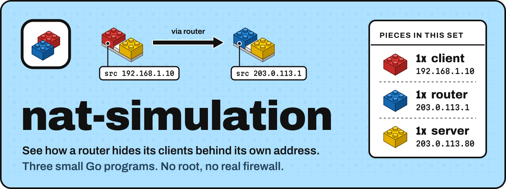
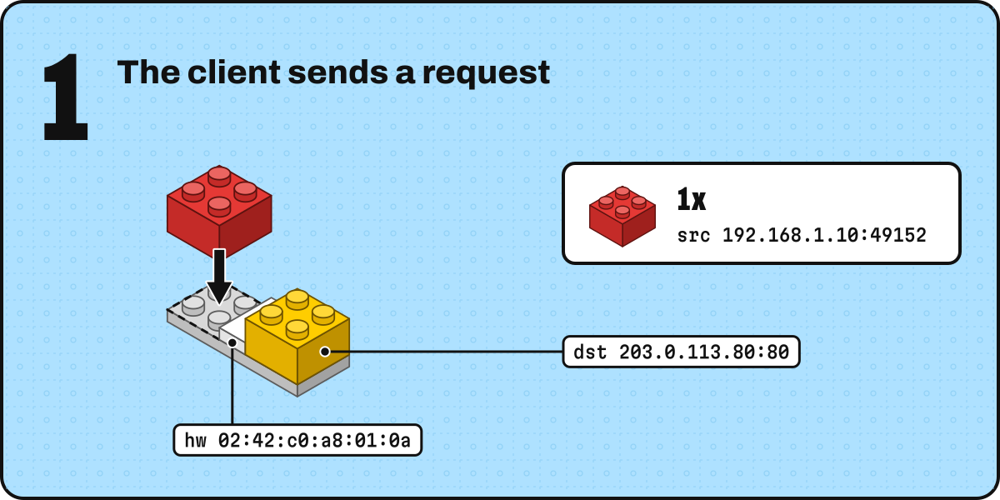
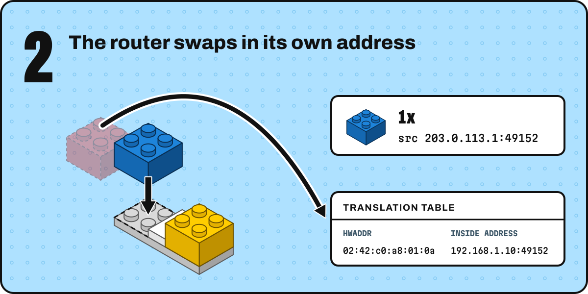
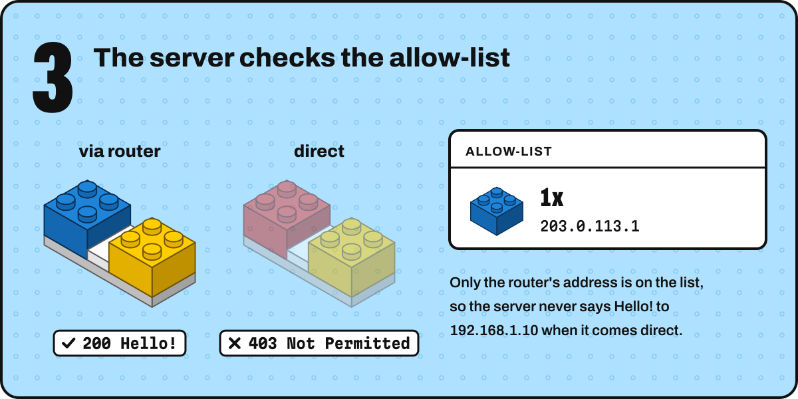
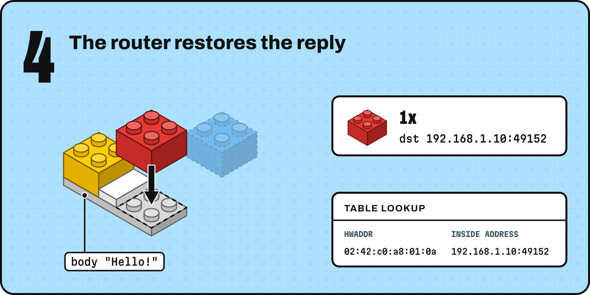

<p align="center">
  <a href="https://github.com/fzn0x/nat-simulation/actions/workflows/ci.yml"></a>
  <a href="go.mod"></a>
  <a href="go.mod"></a>
  <a href="LICENSE"></a>
</p>

**nat-simulation** acts out what `iptables -t nat -A POSTROUTING -j MASQUERADE` does on a Linux router, with three small Go programs standing in for the kernel. A client sends the same request twice: once through a router that masquerades it, and once straight to a server that only trusts the router. One gets `Hello!`, the other gets `Not Permitted`, and the router's log shows exactly what it rewrote to make the difference.

It's a toy for learning. Nothing touches your real firewall, nothing needs root, and it runs the same on Linux, macOS and Windows.

**Contents:** [What you'll see](#what-youll-see) · [Pieces in this set](#pieces-in-this-set) · [Build it](#build-it) · [How it works](#how-it-works) · [Try this next](#try-this-next) · [How the real thing differs](#how-the-real-thing-differs) · [Project layout](#project-layout)

## What you'll see

Every 4 seconds the client prints a round like this:

```text
[client] 18:08:25 round 1: 192.168.1.10:49152 -> 203.0.113.80:80
[client] 18:08:25   via router  200 Hello!         reply to 192.168.1.10:49152
[client] 18:08:25   direct      403 Not Permitted  reply to 192.168.1.10:49152
```

Same client, same request, same reply address. The only difference is the path, and the only thing the router changed on the way is the **source address**. Notice that the client can't tell: both replies come back addressed to `192.168.1.10`. Hiding that change from the client is what masquerading means.

## Pieces in this set

| Piece                                     | Plays the part of                             | Simulated address                      |
| ----------------------------------------- | --------------------------------------------- | -------------------------------------- |
| **1x client** in [`client/`](client/main.go) | A laptop on your home network              | `192.168.1.10`, hw `02:42:c0:a8:01:0a` |
| **1x router** in [`router/`](router/main.go) | Your home router, doing the masquerade     | `203.0.113.1` (its public address)     |
| **1x server** in [`server/`](server/main.go) | A server on the internet with an allow-list | `203.0.113.80`                        |

The public addresses come from `203.0.113.0/24`, a block reserved for documentation ([RFC 5737](https://www.rfc-editor.org/rfc/rfc5737)), so they never point at a real machine. `192.168.1.0/24` is ordinary private address space, the kind your own router hands out.

## Build it

You need [Go 1.21 or newer](https://go.dev/dl/). Open three terminals in the repository and start the programs in this order:

```sh
./server/serverexec    # terminal 1: the internet
./router/routerexec    # terminal 2: the masquerade
./client/clientexec    # terminal 3: the experiment
```

On Windows, in Command Prompt or PowerShell, use the `.cmd` launchers instead: `server\serverexec.cmd`, `router\routerexec.cmd`, `client\clientexec.cmd`.

Each launcher calls `go run`, so the first start takes a moment to compile. Pass `-h` to any launcher to see its flags, and stop everything with <kbd>Ctrl</kbd>+<kbd>C</kbd>.

## How it works

All three programs really talk to each other over HTTP on `127.0.0.1`, so the operating system would report the same address for everyone. The "network" addresses therefore travel inside each request as a small JSON packet, where the router can rewrite them the way a real router rewrites an IP header.

<picture>
  <source media="(max-width: 600px)" srcset="assets/step-1-narrow.svg">
  
</picture>

**1. The client sends a request.** Its source is its own private address. It also carries the client's hardware (MAC-style) address, which the router will use as a filing key.

```json
{"src": "192.168.1.10:49152", "dst": "203.0.113.80:80", "hwaddr": "02:42:c0:a8:01:0a", "body": "hello"}
```

<picture>
  <source media="(max-width: 600px)" srcset="assets/step-2-narrow.svg">
  
</picture>

**2. The router swaps in its own address.** It writes down where the packet really came from, keyed by hardware address, then replaces the source with its public address. The port stays the same. This is the masquerade, and it takes three lines of [`router/main.go`](router/main.go).

```text
[router] 18:08:25 OUT  src=192.168.1.10:49152    dst=203.0.113.80:80       hw=02:42:c0:a8:01:0a body="hello"
[router] 18:08:25      recorded 02:42:c0:a8:01:0a -> 192.168.1.10:49152
[router] 18:08:25      rewrote src 192.168.1.10:49152 -> 203.0.113.1:49152
```

<picture>
  <source media="(max-width: 600px)" srcset="assets/step-3-narrow.svg">
  
</picture>

**3. The server checks the allow-list.** It only reads the source address and compares it with its list, which by default holds just the router. The routed copy passes. The direct copy, still wearing the client's private address, is turned away.

```text
[server] 18:08:25 ALLOW 203.0.113.1:49152    on the allow-list, replying Hello!
[server] 18:08:25 DENY  192.168.1.10:49152   not on the allow-list, replying Not Permitted
```

<picture>
  <source media="(max-width: 600px)" srcset="assets/step-4-narrow.svg">
  
</picture>

**4. The router restores the reply.** The server answered the router's address, so the router looks up the hardware address carried in the reply, puts the client's real address back as the destination, and hands the reply over.

```text
[router] 18:08:25 IN   src=203.0.113.80:80       dst=203.0.113.1:49152     hw=02:42:c0:a8:01:0a body="Hello!"
[router] 18:08:25      restored dst 203.0.113.1:49152 -> 192.168.1.10:49152
```

### Peek at the translation table

While the router runs, it serves its table as plain text:

```console
$ curl http://127.0.0.1:8000/table
HWADDR              INSIDE ADDRESS
02:42:c0:a8:01:0a   192.168.1.10:49153
```

Each client gets one row, updated every round as its source port changes.

## Try this next

Each experiment takes one extra command. Keep the other terminals running unless the step says otherwise.

1. **Add a second client.** In a fourth terminal, run `./client/clientexec -addr 192.168.1.11 -hw 02:42:c0:a8:01:0b`. The table grows a second row, and both clients reach the server as `203.0.113.1`. Watch the server log: both can show up as `203.0.113.1:49152`. Read [how the real thing differs](#how-the-real-thing-differs) to see why that clash matters.
2. **Trust the client directly.** Restart the server with `./server/serverexec -allow 203.0.113.1,192.168.1.10`. Now the direct request gets `Hello!` too. The allow-list was the only thing in the way.
3. **Stop the router.** Press <kbd>Ctrl</kbd>+<kbd>C</kbd> in the router's terminal. The routed request now fails with `can't reach the router`, and the direct one is still `Not Permitted`. Without the masquerade, the client has no way in.
4. **Give the router a new public address.** Restart it with `./router/routerexec -wan 198.51.100.7`. Both requests are now rejected, because the server trusts an *address*, not a machine.

## How the real thing differs

The simulation keeps the idea and drops the machinery. If you go on to configure a real router, these are the differences that will matter:

- **The kernel rewrites packets, not requests.** Real masquerading happens in the `nat` table of Linux's netfilter, in the `POSTROUTING` chain, on the IP header of every packet as it leaves the router.
- **Translations are keyed by connection, not by hardware address.** Linux's connection tracking (`conntrack`) files each translation under the connection's protocol plus its source and destination addresses and ports. A MAC address only means something on the local link and is replaced at every hop, so a real server never sees the client's MAC and couldn't send it back. This simulation carries `hwaddr` all the way so you can watch the lookup happen.
- **Ports are rewritten when they clash.** If two inside hosts use the same source port to reach the same server, a real router gives one of them a different public port. Experiment 1 shows exactly that clash. Here the hardware address keeps the two apart, but a real router has to change the port.
- **`MASQUERADE` follows the interface's address.** It uses whatever address the outgoing interface has right now, which suits a dynamic, DHCP-assigned public IP. `SNAT --to-source` pins a fixed address instead. In this simulation the address is just the `-wan` flag.
- **Entries expire.** `conntrack` forgets idle connections after a timeout. This table keeps one row per hardware address until the router restarts.

For reference, here is the real setup on a Linux router. Don't run it on your own machine unless you know you want to:

```sh
sysctl -w net.ipv4.ip_forward=1                         # let the machine forward packets
iptables -t nat -A POSTROUTING -o eth0 -j MASQUERADE    # masquerade whatever leaves via eth0
conntrack -L                                            # list the real translation table
```

## Project layout

```text
client/            the experiment: one request, two paths
  main.go
  clientexec       launcher (clientexec.cmd on Windows)
router/            the masquerade
  main.go          rewrite on the way out, restore on the way back
  table.go         the translation table
  routerexec
server/            the allow-list
  main.go
  serverexec
internal/packet/   the simulated packet all three programs share
assets/            logo and README artwork
```

Run the tests with `go test ./...`.

## Contributing

Fixes, clearer explanations and new experiments are all welcome. In a teaching project, "I got lost here" is a bug report too, so [tell us where](https://github.com/fzn0x/nat-simulation/issues/new/choose). Read [CONTRIBUTING.md](CONTRIBUTING.md) before opening a pull request. Everyone taking part follows the [Code of Conduct](CODE_OF_CONDUCT.md).

## License

[MIT](LICENSE) © fzn0x

<p align="center"></p>
